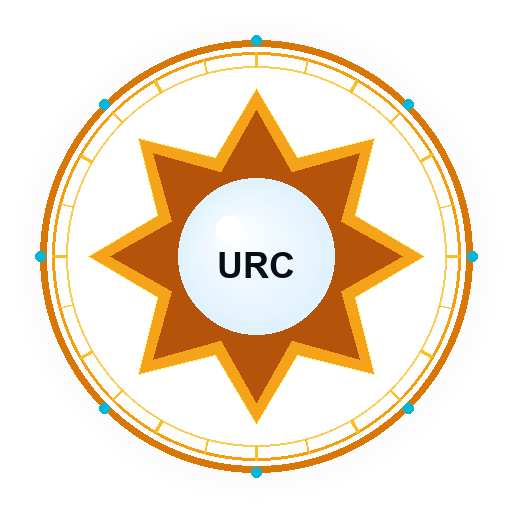

# 🪙 عملة أور الرقمية | Ur Coin (URC) & UrMiner Pro (Kryptex Edition)



**عملة رقمية حقيقية مستقلة (Layer-1 Blockchain)** مبنية من الصفر وفق معمارية UTXO، مزودة بخوارزمية إثبات العمل المقاومة لأجهزة التعدين الاحتكارية (ASIC-Resistant PoW) وتتبع نفس الفلسفة التقنية لعملات PoW الرائدة مثل **Pearl (PRL)** و **Ravencoin** و **Ethereum Classic**، بحيث تعدن حصرياً عبر كروت الشاشة (GPUs)، وتتمتع ببورصة تداول وسواب مدمجة لإتاحة بيعها وشرائها في الأسواق فورياً، ومرفقة بتطبيق تعدين متطور لسطح المكتب **UrMiner Pro** يحاكي معمارية وأداء برنامج **Kryptex**.

---

## 🌟 أبرز مميزات عملة Ur Coin والتطبيق التعديني

### 1. تطبيق التعدين لسطح المكتب UrMiner Pro (معمارية Kryptex)
- **واجهة مستخدم احترافية بالوضع الداكن (Dark Cyber Mode)** مبنية بأحدث معايير CustomTkinter.
- **زر تعدين فوري بنقرة واحدة (1-Click Start/Stop Mining)** دون الحاجة لكتابة أوامر سطرية.
- **مؤشرات أداء وهاردوير حية ومباشرة (Real-Time Hardware Telemetry)** عبر مكتبة `nvidia-ml-py` الأصلية:
  * درجة حرارة كرت الشاشة الحقيقية (°C) مع شارة أمان ملونة (أخضر / أصفر / أحمر).
  * سرعة دوران المراوح (Fan Speed %).
  * الاستهلاك الفعلي للطاقة بالواط (Power Draw in Watts).
  * نسبة استهلاك معالج الرسوميات (GPU Load %).
  * استهلاك الذاكرة العشوائية لكرت الشاشة (VRAM Usage GB / Total GB).
  * نسبة استهلاك المعالج المركزي ورام الجهاز (CPU & RAM Usage).
- **حارس الأمان من الحرارة الزائدة (Thermal Overheat Watchdog)**:
  * إيقاف تلقائي للتعدين فور وصول كرت الشاشة إلى حد الأمان المحدد (افتراضياً 79°C).
  * ظهور تنبيه مرئي يوضح تبريد الكرت.
  * استئناف التعدين تلقائياً وبشكل ذاتي بمجرد انخفاض الحرارة دون أي تدخل بشري.
- **محرك فحص وقياس كفاءة الجهاز (Kryptex Automated Benchmark)**:
  * اختبار أداء كرت الشاشة والمعالج عبر كافة الأنماط (Smart Eco Mode / Pro Max Mode / CPU Worker).
  * حساب سرعة التعدين الفعلية (Hashrate) بدقة.
  * حساب كفاءة الطاقة (kH/W).
  * عرض بطاقة تقرير الأداء والتوصية بالنمط الأنسب للجهاز.
- **حاسبة أرباح حية وفورية (Live Profitability Calculator)**:
  * مرتبطة لحظياً بسعر صرف العملة في بورصة UrDEX.
  * عرض الأرباح المقدرة بالساعة، واليوم (24 ساعة)، والشهر بعملة URC والدولار الرقمي (USDT).

---

### 2. معمارية شبيهة بعملة Pearl (GPU-First & Market Ready)
- **خوارزمية UrHash-v1 المقاومة للـ ASIC (Memory-Hard PoW)**:
  * مستوحاة من فلسفة Ethash المطبقة في عملة Pearl، والتي تضمن اعتماد التعدين على سرعة وعرض نطاق ذاكرة كرت الشاشة GDDR6 لمنع أجهزة الـ ASIC ومعالجات السيرفرات من احتكار الشبكة.
  * توليد جدول DAG في ذاكرة كرت الشاشة بحجم 1.0 إلى 2.0 جيجابايت.
  * نمط **Zero-VRAM Light GPU Mode** لدعم اللابتوبات وكروت الشاشة الاقتصادية دون أي تعليق لنظام التشغيل أثناء العمل أو اللعب.
  * فحص كتل سريع (Light-Verification) يستغرق أقل من 1 ملي ثانية.
- **جاهزية الإدراج في الأسواق والبورصات (Market Listing & DEX Ready)**:
  * محرك تداول مدمج (UrDEX P2P Order Book & Continuous Double Auction).
  * مجمع تحويل فوري (Instant Swap) بين URC و USDT بنقرة واحدة داخل المحفظة وتطبيق التعدين.
  * واجهة برمجية معيارية لمنصات رصد الأسعار (مثل CoinGecko و CoinMarketCap) عبر المنفذ:
    `GET /api/v1/ticker` و `GET /api/exchange/ticker`.

---

### 3. هوية بصرية وشعار مميز (Distinctive Visual Branding)
- شعار فريد يجمع بين النجمة الشمسية لمدينة أور السومرية القديمة وحلقة التشفير السيبرانية ولؤلؤة التعدين المركزية المتوهجة.
- توفر الشعار بصيغ:
  * `assets/urcoin_logo.svg`: شعار متجهي فائق الدقة.
  * `assets/urcoin_logo.png`: صورة عالية الدقة (512x512).
  * `assets/urcoin_logo.ico`: أيقونة نظام ويندوز لتطبيق التعدين واختصار سطح المكتب.

---

## 📊 المواصفات التقنية للعملة (Coin Specifications)

| الخاصية | القيمة |
| :--- | :--- |
| **اسم العملة** | Ur Coin |
| **رمز العملة** | **URC** |
| **الحد الأقصى للعرض (Max Supply)** | 21,000,000 URC |
| **مكافأة الكتلة الأولية** | 50 URC لكل كتلة |
| **زمن الكتلة المستهدف** | 30 ثانية |
| **تنصيف المكافأة (Halving)** | كل 210,000 كتلة |
| **الأجزاء العشرية (Decimals)** | 8 خانات (1 URC = 100,000,000 atomic units) |
| **خوارزمية التعدين** | **UrHash-v1** (Memory-Hard PoW + Zero-VRAM Mode) |
| **نموذج المعاملات** | UTXO + تواقيع ECDSA SECP256k1 (RFC 6979) |
| **تطبيق التعدين المكتبي** | UrMiner Pro (معمارية شبيهة بـ Kryptex) |
| **منفذ الند للند (P2P Port)** | `9333` |
| **منفذ العقدة والواجهة (RPC & Web API)** | `9334` |

---

## 🚀 كيفية تشغيل المشروع

### 1. تشغيل تطبيق التعدين المكتبي (UrMiner Pro - Kryptex Edition)
انقر نقراً مزدوجاً على الملف:
```cmd
UrMiner.bat
```
أو عبر الاختصار المنشأ على سطح المكتب:
👉 **`UrMiner Pro.lnk`**

أو عبر موجه الأوامر:
```powershell
python urminer_gui.py
```
ستفتح واجهة التعدين الاحترافية مباشرة:
1. انقر على زر **START MINING** لبدء التعدين فوراً.
2. توجه لتبويب **Benchmark** لقياس كفاءة وأرباح جهازك.
3. توجه لتبويب **Wallet & Payouts** لسحب الأرباح أو تحويلها إلى USDT.

---

### 2. تشغيل العقدة الكاملة ولوحة التحكم (Node Daemon)
قم بالنقر المزدوج على:
```cmd
start_node.bat
```
أو عبر الطرفية:
```powershell
python urcoind.py
```
ثم افتح المستكشف عبر المتصفح:
👉 **`http://localhost:9334/`**

---

### 3. إنشاء اختصار سطح المكتب بالأيقونة المميزة
إذا أردت تجديد اختصار سطح المكتب بشعار العملة الرسمي:
```powershell
python create_shortcut.py
```

---

## 📁 هيكلية ملفات المشروع المحدثة

```text
modest-chandrasekhar/
│
├── assets/                     # أصول الهوية البصرية وشعار العملة
│   ├── urcoin_logo.svg         # الشعار المتجهي للويب
│   ├── urcoin_logo.png         # الشعار عالي الدقة (512x512)
│   └── urcoin_logo.ico         # أيقونة ويندوز لتطبيق التعدين
│
├── urcoin/                     # النواة البرمجية للبلوكشين
│   ├── crypto.py               # التشفير، توقيعات SECP256k1، وخوارزمية UrHash
│   ├── core.py                 # هياكل الكتل، المعاملات، الـ UTXO، والتنصيف
│   ├── storage.py              # قاعدة بيانات SQLite للكتل، الكتل البديلة، وسجلات التراجع
│   ├── consensus.py            # التحقق من الإجماع وضبط الصعوبة
│   ├── exchange.py             # بورصة UrDEX وسواب العملات وسجل الصفقات
│   ├── miner_gpu.py            # مشغل التعدين لكروت الشاشة (OpenCL & NVML) والمعالجات
│   ├── mempool.py              # مجمع المعاملات غير المؤكدة
│   ├── network.py              # بروتوكول الند للند (P2P Gossip)
│   ├── rpc.py                  # خادم JSON-RPC وواجهة أسواق CoinGecko
│   ├── wallet.py               # إدارة المحافظ والمفاتيح وعبارة الاسترجاع
│   ├── web_ui.py               # لوحة تحكم الويب المدمجة بشعار SVG
│   └── kernels/
│       └── urhash.cl           # كود نواة كرت الشاشة (OpenCL Memory-Hard Kernel)
│
├── urminer_gui.py              # تطبيق التعدين المكتبي الرائد (معمارية Kryptex)
├── gui_miner.py                # موجه تشغيل متوافق مع كافة الإصدارات
├── urcoin_miner.py             # برنامج التعدين عالي السرعة عبر الطرفية (CLI)
├── urcoind.py                  # خادم العقدة الكاملة (Full Node Daemon)
├── urcoin_cli.py               # أداة سطر الأوامر لإدارة المحفظة
│
├── test_kryptex_miner.py       # اختبارات شاملة لتطبيق التعدين والهاردوير والبورصة
├── test_consensus.py           # اختبارات قواعد الإجماع وصحة البلوكشين
├── test_exchange_and_adaptive.py # اختبارات التداول ومطابقة الأوامر والتعدين التكيفي
├── test_e2e.py                 # اختبار التحقق الشامل للنظام
│
├── UrMiner.bat                 # تشغيل تطبيق التعدين المكتبي بنقرة واحدة
├── start_miner.bat             # تشغيل التعدين (خيارات واجهة أو طرفية)
├── start_node.bat              # تشغيل العقدة الكاملة بنقرة واحدة
├── mine.bat                    # تشغيل معدن الطرفية مباشرة
├── create_shortcut.py          # إنشاء اختصار سطح المكتب بالأيقونة والشعار
└── README.md                   # التوثيق الشامل والمحدث
```

---

## 🔒 الموثوقية والأمان (Trust & Reliability)
1. **الحماية ضد الإنفاق المزدوج**: يتم استهلاك وتأكيد مدخلات الـ UTXO في قاعدة بيانات المعاملات عبر معاملات ذرية مشفرة.
2. **تواقيع حتمية RFC 6979**: تمنع أي احتمالية لتسريب المفتاح الخاص أثناء توقيع المعاملات.
3. **أمان الهاردوير**: تطبيق UrMiner Pro يراقب حرارة كرت الشاشة في الزمن الفعلي ويوقف التعدين ذاتياً لحماية الكرت من الإجهاد الحراري.
4. **سيولة وسوق فوري**: إمكانية بيع العملة ومبادلتها فورياً بالـ USDT دون الحاجة لطرف ثالث وسيط.
